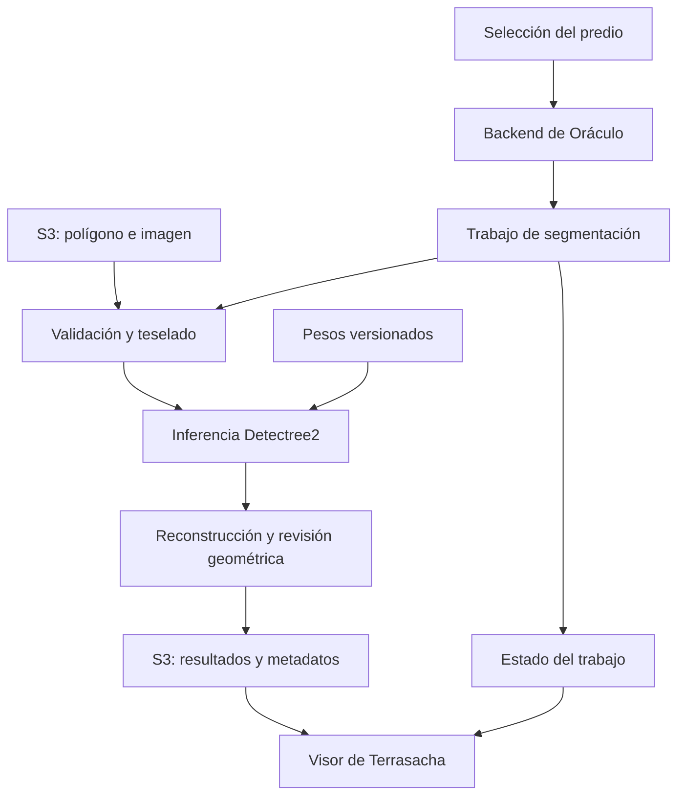

# Segmentación de copas de árboles para Terrasacha — Oráculo

Documentación del modelo, las pruebas realizadas y su integración con la plataforma.

**Estado:** prototipo experimental e integración en desarrollo.  
**Modelo de referencia:** Detectree2 / Mask R-CNN.  
**Pesos:** `230729_05dates.pth`.  
**Actualización:** 22 de octubre de 2026.

## Propósito

Este módulo busca delimitar copas individuales de árboles en ortomosaicos RGB de alta resolución y convertir las predicciones en capas geográficas consultables desde Terrasacha. Su incorporación a Oráculo permitirá solicitar el análisis de un área de interés, conservar los resultados y revisarlos sobre la imagen del predio.

El trabajo comprende dos frentes: las pruebas del modelo en Colab y la preparación de su conexión con los datos almacenados en Amazon S3. La integración completa entre selección del área, procesamiento, almacenamiento y visualización sigue pendiente.

El modelo identificado en las pruebas es **Detectree2, basado en Mask R-CNN y Detectron2**. Los borradores anteriores que describen un flujo YOLO requieren adaptar su componente de inferencia a este modelo: cargar un archivo `.pth` de Detectree2 no equivale a cargar un checkpoint YOLO.

## Fundamento científico y procedencia del modelo

### Artículo original de Detectree2

**Ball, J. G. C., et al. (2023).** *Accurate delineation of individual tree crowns in tropical forests from aerial RGB imagery using Mask R-CNN*. **Remote Sensing in Ecology and Conservation, 9**(5), 641–655.  
**DOI:** [10.1002/rse2.332](https://doi.org/10.1002/rse2.332).

Este trabajo presenta Detectree2 para delinear copas individuales a partir de imágenes aéreas RGB. La segmentación de instancias permite asignar una máscara diferente a cada copa detectada. Es la referencia principal del método y la publicación que sus desarrolladores solicitan citar.

### Referencia del checkpoint empleado

**Ball, J. G. C., et al. (2024).** *Harnessing temporal and spectral dimensionality to map and identify species of individual trees in diverse tropical forests*. **bioRxiv, preprint**.  
**DOI:** [10.1101/2024.06.24.600405](https://doi.org/10.1101/2024.06.24.600405).

La ficha de los pesos en Zenodo identifica `230729_05dates.pth` como el modelo **“5 date”** de ese trabajo. Parte de `230717_base.pth` y fue ajustado con imágenes RGB de UAV de cinco fechas de Paracou, con resolución aproximada de 5 cm/píxel. La ficha lo orienta a imágenes RGB de UAV de alta resolución y dosel tropical cerrado.

El título del preprint también menciona identificación de especies. **El checkpoint empleado aquí se utiliza para delimitar copas, con una clase de árbol; no se presenta como un clasificador de especies.** Tampoco produce directamente altura, biomasa, carbono o diagnóstico fitosanitario.

### Ficha técnica

| Elemento | Especificación |
|---|---|
| Biblioteca | Detectree2, sobre Detectron2 |
| Arquitectura | Mask R-CNN con backbone ResNet-101 y FPN |
| Configuración de referencia | `COCO-InstanceSegmentation/mask_rcnn_R_101_FPN_3x.yaml` |
| Archivo de pesos | `230729_05dates.pth` |
| Entrada del modelo | Imagen RGB preparada para el predictor |
| Salida del predictor | Instancias con máscara, caja, clase y puntuación |
| Clase usada en las pruebas | `0 = tree` |
| Tamaño del archivo publicado | Aproximadamente 498 MB |
| MD5 publicado por Zenodo | `31e1f709b34a95eaa5966b4f9812d560` |

Fuente del checkpoint y sus características: [Detectree2 trained models, versión v4, Zenodo](https://doi.org/10.5281/zenodo.15863800).

## Avances y estado de la integración

Los siguientes antecedentes proceden de las pruebas y actividades reportadas en el proyecto. Este README no representa una nueva ejecución del modelo.

| Componente | Avance registrado | Trabajo restante |
|---|---|---|
| Entorno de inferencia | Uso de Detectree2 y Detectron2 en Colab con `230729_05dates.pth`. | Consolidar un entorno reproducible para el servicio. |
| Preparación de imágenes | Lectura de ortomosaicos y preparación de tres bandas RGB a partir de archivos de cuatro bandas. | Automatizar la validación de bandas, radiometría, nodata y sistema de coordenadas. |
| Prueba de agosto | En `RGB_Navajas_LiDAR_BBOX.tif`, un recorte de 1953 × 1857 píxeles en EPSG:3116, se reportaron 12 teselas y 12 JSON de predicciones. | Revisar máscaras y completar la reconstrucción geográfica del resultado. |
| Polígono desde S3 | Se reportó una primera prueba de carga y lectura del área de interés. | Registrar las claves reales, permisos y evidencias de una corrida reproducible. |
| Servicio de procesamiento | Se está definiendo la conexión del modelo con el flujo de la plataforma. | Implementar y comprobar la ejecución del trabajo desde el backend. |
| Resultados geográficos | Se dispone de predicciones por tesela como punto de partida. | Convertir máscaras a polígonos, resolver duplicados y exportar la capa final. |
| Visualización | El visor se contempla como apoyo para revisar el área y los resultados. | Conectar la capa de copas con el resultado del trabajo y comprobar su alineación. |
| Evaluación | Pendiente de consolidación. | Medir calidad con referencias locales y rendimiento de ejecución. |

Las pruebas de costos de Lambda de los modelos de biomasa son un desarrollo separado. No constituyen evidencia de que este modelo de copas esté desplegado ni permiten asignarle automáticamente sus tiempos o costos.

## Cómo funciona el procesamiento

### 1. Selección del área y asociación de la imagen

El usuario selecciona o carga un polígono del predio. El sistema debe asociarlo con un ortomosaico RGB correspondiente al lugar y a la fecha del análisis.

**El polígono delimita dónde analizar; el modelo procesa los píxeles de la imagen.** Para ejecutar la segmentación se necesitan ambos insumos. Un GeoJSON aislado no contiene la información visual de las copas.

### 2. Lectura desde S3 y validación

El backend identifica los objetos de entrada y el proceso de inferencia los recupera desde S3. Antes de segmentar debe comprobar:

- Existencia y permisos de lectura de los objetos.
- Geometría válida del área de interés y correspondencia espacial con el raster.
- CRS, resolución, extensión, bandas y valores nodata del ortomosaico.
- Disponibilidad del checkpoint y correspondencia con la configuración del modelo.

El área se reproyecta al CRS del raster para efectuar el recorte. La banda alfa de una imagen RGBA debe tratarse como información de transparencia o validez; se debe definir explícitamente cómo excluir sus píxeles sin información.

### 3. Preparación de teselas

El ortomosaico se divide en fragmentos manejables con solapamiento. Cada tesela conserva la información necesaria para recuperar su posición en el predio.

El tamaño de tesela, el solapamiento y el redimensionamiento de entrada deben ajustarse a la resolución y al tamaño de las copas. No se trasladan automáticamente parámetros de un prototipo YOLO al procesamiento con Detectree2.

### 4. Inferencia

Detectree2 carga el checkpoint y predice instancias sobre cada tesela. Se conservan las máscaras y sus puntuaciones para la revisión y el procesamiento posterior.

La puntuación expresa la confianza del predictor; por sí sola no valida que la copa sea correcta. Una ejecución exitosa o un archivo JSON generado tampoco equivalen a una precisión medida.

### 5. Reconstrucción geográfica

Las máscaras se transforman desde coordenadas de imagen al sistema de coordenadas del raster. Después se unen los resultados de las teselas, se revisan las geometrías y se resuelven las predicciones repetidas en áreas de solapamiento.

Las operaciones de unión y filtrado deben preservar copas vecinas distintas. También deben tratar las copas fragmentadas en bordes y aquellas que cruzan el límite del área de interés. Si se recorta una copa al límite, su área resultante debe identificarse como parcial.

Detectree2 documenta funciones para este flujo, entre ellas `project_to_geojson`, `stitch_crowns` y `clean_crowns`. Su adaptación y validación en el proyecto sigue pendiente. Véase la [guía oficial de predicción](https://patball1.github.io/detectree2/tutorials/04_prediction.html).

### 6. Publicación y revisión

El proceso guarda la capa geográfica y un resumen de ejecución. La plataforma consulta el estado del trabajo y permite visualizar las copas sobre el ortomosaico y descargar el resultado.

El conteo corresponde inicialmente a **copas candidatas detectadas**, hasta completar su evaluación. La superposición visual ayuda a revisar desplazamientos y errores, pero debe acompañarse de una validación cuantitativa.

## Integración prevista en Terrasacha

El siguiente esquema representa el flujo que se busca completar; no certifica un despliegue operativo de todos los componentes.



### Responsabilidades

| Componente | Función prevista |
|---|---|
| Interfaz | Seleccionar predio, imagen y área de interés; solicitar el análisis. |
| Backend de Oráculo | Validar la solicitud, autorizar los objetos y generar un identificador de trabajo. |
| Ejecutor de inferencia | Preparar datos, cargar Detectree2 y producir resultados geográficos. |
| Amazon S3 | Almacenar entradas, versiones del modelo, resultados y registros. |
| Registro de trabajos | Conservar estado, parámetros, errores y referencias a los resultados. |
| Visor | Consultar el trabajo, superponer las copas y ofrecer la descarga. |

Se propone una ejecución asíncrona: el backend devuelve un identificador y el procesamiento continúa en un ejecutor. La selección del servicio de cómputo y sus recursos debe hacerse con mediciones del modelo sobre imágenes representativas. La participación de Lambda, si se adopta para coordinar solicitudes, no implica que la inferencia ya se ejecute allí.

### Datos de una solicitud

Ejemplo de estructura **propuesta**, pendiente de implementar en el backend. Los nombres y rutas son ilustrativos; no representan objetos existentes.

```json
{
  "project_id": "predio-ejemplo",
  "aoi_s3_uri": "s3://BUCKET_CONFIGURADO/entradas/aoi.geojson",
  "image_s3_uri": "s3://BUCKET_CONFIGURADO/entradas/ortomosaico_rgb.tif",
  "model_id": "detectree2-230729_05dates",
  "parameters": {
    "score_threshold": 0.5
  }
}
```

El umbral 0,5 es un valor ilustrativo que debe ajustarse mediante validación. El backend debe resolver `model_id` hacia una versión autorizada de pesos y configuración. Los estados propuestos del trabajo son `queued`, `running`, `succeeded` y `failed`.

### Productos esperados

| Producto | Contenido |
|---|---|
| `crowns.geojson` | Copas candidatas para el visor, exportadas en longitud/latitud WGS84. |
| `crowns.gpkg` | Capa para análisis SIG, conservada en un CRS adecuado para mediciones. |
| `summary.json` | Conteo, parámetros, duración y estado del procesamiento. |
| `manifest.json` | Entradas, versión del modelo, huella de pesos, CRS y versiones del entorno. |
| Registro de ejecución | Mensajes, fallos y evidencia de cada etapa. |

Para cada copa se propone conservar `crown_id`, `job_id`, `score`, `model_id` y `area_m2`. Las áreas deben calcularse en un CRS proyectado adecuado, no directamente en grados. El área de la unión de copas debe calcularse por separado de la suma de áreas individuales para evitar contar dos veces zonas superpuestas.

## Descarga y preparación del modelo

**Descarga directa:** [230729_05dates.pth](https://zenodo.org/records/15863800/files/230729_05dates.pth?download=1).

En PowerShell, desde la carpeta de trabajo:

```powershell
New-Item -ItemType Directory -Force -Path models | Out-Null
curl.exe -L --fail --retry 3 "https://zenodo.org/records/15863800/files/230729_05dates.pth?download=1" -o "models/230729_05dates.pth"
Get-FileHash "models/230729_05dates.pth" -Algorithm MD5
Get-FileHash "models/230729_05dates.pth" -Algorithm SHA256
```

En una celda de Colab:

```python
!wget -c "https://zenodo.org/records/15863800/files/230729_05dates.pth?download=1" -O /content/230729_05dates.pth
```

Comparar el MD5 con el publicado en la ficha técnica. Registrar también SHA256 para identificar la copia incorporada al proyecto. Los pesos se mantienen fuera del historial Git y se descargan de la fuente o de un almacenamiento de modelos autorizado.

### Entorno de ejecución

Se requieren Python, PyTorch/torchvision compatibles, Detectron2, Detectree2 y las dependencias geoespaciales del procesamiento. La instalación debe seguir la [documentación oficial](https://patball1.github.io/detectree2/installation.html), atendiendo a la compatibilidad de CUDA y GDAL cuando corresponda.

El entorno definitivo debe quedar fijado mediante versiones y una imagen o configuración reproducible. No se ha verificado una instalación nueva como parte de la elaboración de este README.

### Ejemplo mínimo de carga

Este fragmento muestra la configuración del predictor una vez preparado el entorno y descargados los pesos. **No implementa por sí solo la lectura de S3, el teselado ni el despliegue.**

```python
from pathlib import Path
import torch
from detectree2.models.train import setup_cfg
from detectron2.engine import DefaultPredictor

weights = Path("models/230729_05dates.pth")
if not weights.is_file():
    raise FileNotFoundError(weights)

cfg = setup_cfg(
    base_model="COCO-InstanceSegmentation/mask_rcnn_R_101_FPN_3x.yaml",
    update_model=str(weights),
)
cfg.MODEL.ROI_HEADS.NUM_CLASSES = 1
cfg.MODEL.ROI_HEADS.SCORE_THRESH_TEST = 0.5  # Valor inicial por validar
cfg.MODEL.DEVICE = "cuda" if torch.cuda.is_available() else "cpu"

predictor = DefaultPredictor(cfg)
```

En Colab, sustituir la ruta por `/content/230729_05dates.pth`. El predictor debe recibir la imagen con el orden de canales y el preprocesamiento esperados por la configuración. La preparación geográfica debe conservar la transformación de cada tesela. Referencia de uso: [tutorial oficial de primera predicción](https://patball1.github.io/detectree2/tutorials/01_getting_started.html).

## Qué falta para completar la integración

| Prioridad | Trabajo pendiente | Evidencia necesaria para cerrarlo |
|---|---|---|
| 1 | Adaptar el componente de inferencia a Detectree2. | Una misma entrada procesada con el checkpoint identificado y un entorno reproducible. |
| 1 | Confirmar bucket, claves y permisos de entradas, pesos y resultados. | Lectura y escritura verificadas con las credenciales del servicio. |
| 1 | Conectar el área de interés con el ortomosaico correcto. | Recorte válido, correspondencia de CRS y tratamiento de nodata comprobados. |
| 1 | Completar la conversión de máscaras a copas georreferenciadas. | Capa final alineada con el raster y revisión de bordes, duplicados y geometrías. |
| 2 | Implementar el trabajo asíncrono desde Oráculo. | Solicitud, identificador, seguimiento de estado y manejo de fallos. |
| 2 | Integrar los resultados con el visor. | Superposición, consulta por copa y descarga desde un trabajo finalizado. |
| 2 | Evaluar con referencias locales independientes. | Métricas, ejemplos de errores y parámetros seleccionados documentados. |
| 3 | Medir recursos y costos del modelo de copas. | Tiempos, memoria, almacenamiento y costo por área o trabajo. |
| 3 | Ajustar el modelo cuando la evaluación lo justifique. | Comparación reproducible entre la versión inicial y la ajustada. |

### Validación del modelo

Preparar anotaciones de copas representativas de los predios y vuelos de interés. Separar los datos de entrenamiento, ajuste de parámetros y prueba por zonas o vuelos para evitar que teselas solapadas aparezcan en conjuntos distintos.

La evaluación debe incluir precisión, exhaustividad y F1 con emparejamiento uno a uno y umbral IoU declarado; AP de máscaras a IoU 0,50 y, cuando el protocolo lo permita, AP de 0,50 a 0,95. Registrar además omisiones, falsos positivos, copas fusionadas, fragmentación y error de conteo.

Los resultados científicos de otros sitios no sustituyen esta evaluación local. No se han establecido aún métricas de aceptación del proyecto ni se afirma una mejora cuantitativa del checkpoint.

### Criterio de integración completa

- [ ] Una solicitud desde Terrasacha genera un trabajo identificable.
- [ ] El ejecutor recupera desde S3 el área, la imagen y los pesos autorizados.
- [ ] La inferencia y la reconstrucción producen una capa geográfica válida.
- [ ] El resultado, sus parámetros y su procedencia quedan almacenados.
- [ ] El visor presenta la capa alineada y permite su descarga.
- [ ] Los fallos se informan y los reintentos no duplican resultados.
- [ ] La calidad cumple criterios acordados sobre un conjunto independiente.
- [ ] Los recursos y costos permiten operar bajo los límites definidos para la plataforma.

## Referencias y reconocimiento

1. [Artículo original de Detectree2 — Ball et al. (2023)](https://doi.org/10.1002/rse2.332). Referencia bibliográfica completa en la sección de fundamento científico.
2. [Preprint asociado al modelo «5 date» — Ball et al. (2024)](https://doi.org/10.1101/2024.06.24.600405). Referencia bibliográfica completa en la sección de fundamento científico.
3. Ball, J., y Kotthoff, C. (2025). *Detectree2 trained models*, versión v4. Zenodo. [DOI: 10.5281/zenodo.15863800](https://doi.org/10.5281/zenodo.15863800).
4. [Repositorio oficial de Detectree2](https://github.com/PatBall1/detectree2).
5. [Documentación oficial de Detectree2](https://patball1.github.io/detectree2/).

La autoría del método y de los pesos corresponde a sus desarrolladores. El aporte del proyecto consiste en su evaluación con los datos de interés y en la implementación del flujo geoespacial y de plataforma. La licencia del código, los pesos y los datos debe documentarse para cada componente; no se presupone que una misma licencia cubra todos los recursos.

